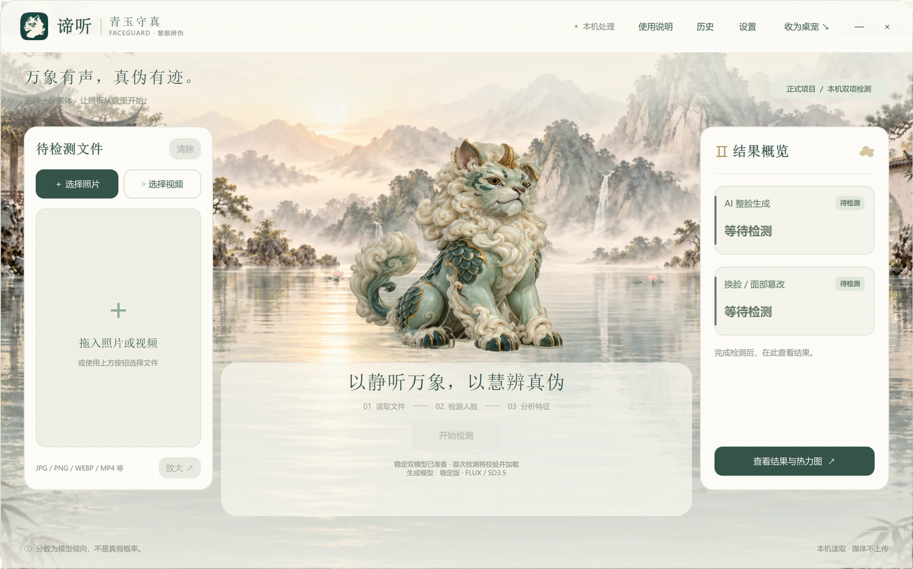
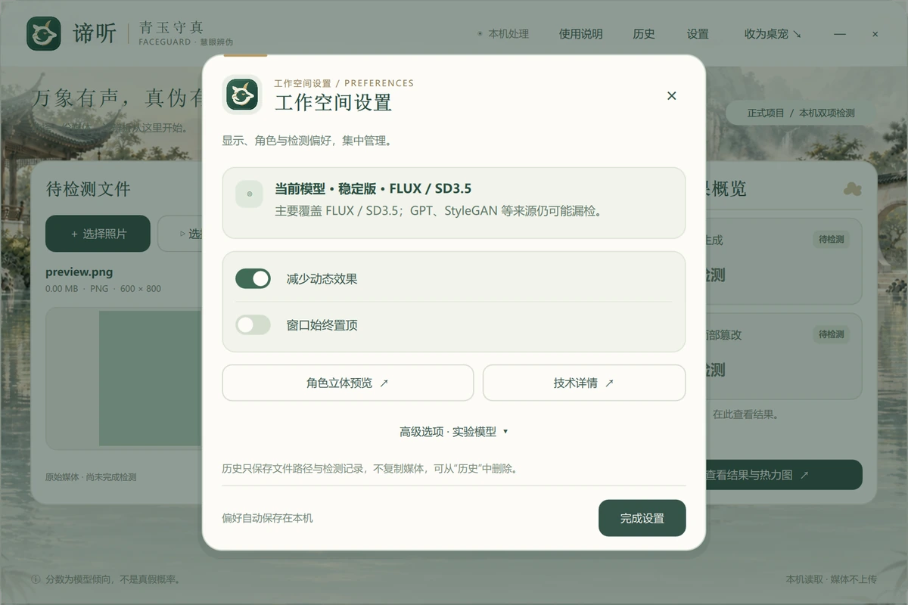
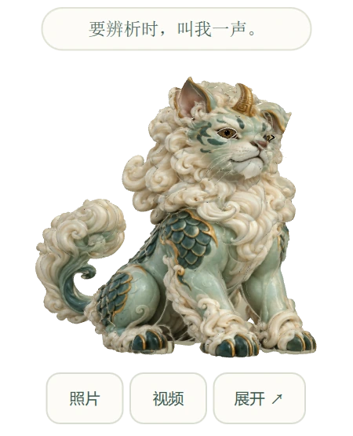
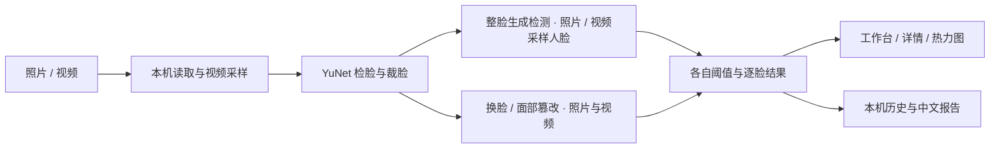

<div align="center">


# 谛听 · FaceGuard

**以静听万象，以慧辨真伪。**

在本机分析人脸照片与视频的 AI 生成、换脸与面部篡改检测工具。

[](https://github.com/pocket996/faceguard/blob/v0.2.0-rc.1/requirements.txt)
[](#快速开始)
[](LICENSE)
[](#版本与获取方式)

[快速开始](#快速开始) · [功能介绍](#功能介绍) · [能力边界](#能力边界) · [项目文档](#项目文档) · [参与贡献](#参与贡献)

</div>



<p align="center"><em>本机开发预览的真实运行截图。默认分支、公开开发分支与下载版的功能范围见下文。</em></p>

## 这是什么？

FaceGuard 将两种容易混淆的问题分开回答：**“这张脸是否由 AI 整体生成？”**和**“这张脸是否被换脸或局部篡改？”**

你可以导入一张照片或一段视频，在本地完成检测，逐脸查看结果与模型关注热力图，再保存中文报告。桌面界面以青玉、古金和水墨庭景为视觉主题，配有可收起的三维谛听桌宠；同一套推理也提供命令行入口，便于批处理脚本和研究复现。

项目面向学习、演示与辅助复核，目前处于开发预览阶段。**检测分数不是“真假概率”，未检出也不等于保证真实。**

## 功能介绍

| 功能 | 可以做什么 |
| --- | --- |
| **照片双项检测** | 分别分析 AI 整脸生成与换脸 / 面部篡改，逐脸展示分数和提示阈值 |
| **视频双项复核** | 分别检查采样人脸的生成与篡改线索；篡改保留原整段基线与局部复核，生成仅作逐帧线索；支持取消 |
| **模型关注热力图** | 支持 Grad-CAM / 遮挡对照与解释方向选择，提供原图、叠加、并排对比、缩放与强度调整 |
| **报告与历史** | 保存中文 PDF / TXT 报告，导出 PNG / PDF 解释图示，搜索和重新打开本机检测记录 |
| **谛听工作台与桌宠** | 同一三维骨骼角色支持待机、回应与检测倾听；可拖动桌宠、置顶和减少动态效果 |
| **实验模型对照** | 在高级选项中显式选择候选，记录实际模型版本；稳定默认与实验候选分开保存 |
| **本地处理与 CLI** | 媒体分析在本机进行，所选文件不上传服务端；支持 CPU 推理与 CUDA 环境 |

本机开发预览包含上述功能，以及淡莲水面、分层眼睛和检测歪头时的双耳轻动。新图标采用用户提供的青玉底、米白谛听侧首图样，统一工作台、弹窗、窗口与托盘显示。淡莲、眼睛 / 耳动、热力图扩展与新图标改动尚未提交或上传；公开开发分支不包含这些本机更新。

### 把日常操作与技术选项分开

导入媒体、开始检测、阅读结论在工作台完成。检测结束后保留当前页面，点击结果入口再查看人脸、采样帧与热力图；技术详情、模型候选和显示偏好放在设置中。



### 不检测时，也可以是一只桌宠

将工作台收起为透明小窗口，平时仅显示角色；鼠标悬停时出现上下提示及照片 / 视频 / 展开按钮，移出后隐藏。双击角色或点击“展开”即可返回。开启“减少动态效果”时角色保持静止。

<p align="center">
  
</p>

## 版本与获取方式

**新版提供 Windows CPU 内测安装包，也可从源码运行。** 安装版无需配置 Python / CUDA，安装后双击桌面或开始菜单“谛听 FaceGuard”，不会弹出命令行窗口。干净电脑验收仍待完成。

| 想体验什么 | 获取入口 | 说明 |
| --- | --- | --- |
| 新版安装体验 | [v0.2.0-rc.1 Windows CPU 安装包](https://github.com/pocket996/faceguard/releases/tag/v0.2.0-rc.1) | 下载 `FaceGuard-v0.2.0-rc.1-windows-x64-cpu-setup.exe`；安装时默认创建快捷方式，模型随包附带 |
| 新版源码与模型 | [v0.2.0-rc.1 源码](https://github.com/pocket996/faceguard/tree/v0.2.0-rc.1) | 需要 Python 环境；运行模型随源码提交，无需训练数据 |
| 免安装基础检测 | [v0.1.0 Windows CPU 预览版](https://github.com/pocket996/faceguard/releases/tag/v0.1.0) | 历史界面，功能较少；不包含本文截图中的新版谛听工作台 |

新版安装包尚未代码签名，Windows 可能显示未知发布者；发布页附 SHA256SUMS.txt。旧 v0.1.0 仍保留作为历史版本。GitHub 自动生成的 Source code 压缩包不是安装程序。

## 快速开始

以下步骤以 **Windows 10 / 11 x64、Python 3.11** 为例。CPU 即可运行，不要求 NVIDIA 显卡。

### 1. 获取新版源码

```powershell
git clone --branch v0.2.0-rc.1 https://github.com/pocket996/faceguard.git
cd faceguard
py -3.11 -m venv .venv
```

### 2. 安装依赖

```powershell
.\.venv\Scripts\python.exe -m pip install --upgrade pip
.\.venv\Scripts\python.exe -m pip install -r requirements-cpu.txt
.\.venv\Scripts\python.exe -m pip install -r requirements.txt
.\.venv\Scripts\python.exe -m pip install -r requirements-ui.txt
```

如果使用兼容的 NVIDIA 显卡，将第一份依赖清单换为 `requirements-gpu.txt`。CUDA / 驱动、FFmpeg 与环境验收步骤见 [环境指南](https://github.com/pocket996/faceguard/blob/v0.2.0-rc.1/docs/TEAM_ENV_SETUP.md)。

### 3. 启动应用

```powershell
.\.venv\Scripts\python.exe run_app.py
# 创建桌面无命令行入口（仅执行一次），以后双击快捷方式
powershell -NoProfile -ExecutionPolicy Bypass -File scripts/create_shortcut.ps1

# 以透明桌宠模式启动
.\.venv\Scripts\python.exe run_app.py --pet
```

在左侧选择照片或视频，点击“开始检测”，完成后在右侧查看概览。首次检测会加载并核验模型，需要一些等待时间。

模型位于 `weights/runtime/`，实验候选位于 `weights/generation-candidates/`，两者都已随公开开发分支提交。请保留配套 manifest、配置和许可证的原始字节；无需下载训练集，也无需自行训练。视频读取和界面渲染仍依赖本机编解码器与图形驱动，其他系统尚未完成桌面实机验收。

### 命令行使用

```powershell
# 照片：分别分析生成与篡改
.\.venv\Scripts\python.exe scripts/predict_official.py "C:\media\photo.jpg" --task both --device cpu --output outputs/photo-result.json

# 视频：分别检查采样人脸的生成与篡改线索（本机源码新增）
.\.venv\Scripts\python.exe scripts/predict_official.py "C:\media\clip.mp4" --task both --device cpu --output outputs/video-result.json
# 也可指定 --task generation 或 --task manipulation；auto 默认双项
```

输入应包含可检测的人脸；没有可分析的人脸时，程序会提示无法判断。

## 它如何工作？



两项检测使用独立的 ResNet18 分支。稳定生成模型主要覆盖 FLUX / SD3.5，篡改分支主要来自 FaceForensics++ 视频帧；后续候选用于研究来源扩展与误报取舍。默认视频依据采样帧的人脸外观进行分析，没有把整段动作作为时序模型输入。

技术栈：**Python · PyTorch / torchvision · OpenCV · PySide6 / Qt Quick 3D · SQLite**。

## 能力边界

- **会误报，也会漏报。** 陌生生成器、压缩截图、侧脸、遮挡、模糊和较小的人脸都可能影响结果。某张图识别成功不能代表对同类工具全面有效。
- **热力图是模型解释，不是篡改定位证据。** 颜色反映单张图内的相对关注强度，不能据此认定红区被修改，也不能用它提高原检测的可信度。
- **视频是有预算的采样分析。** 生成项使用照片模型与照片阈值逐帧检查人脸，尚未标定视频误报率；不分析音频或整幅场景。未采样到的短暂事件仍可能漏掉，目前不提供整段 AI 生成视频的通用判定。
- **任务范围以人脸为主。** 未验证对无脸风景、商品图等任意 AI 图片的检测能力；视频帧模型用于普通照片篡改时仅作辅助线索。
- **实验候选需要按协议比较。** 更高检出可能伴随更多真实照片误报，候选不会因为训练完成而自动替换稳定默认。

实验条件、负面结果和复现材料见 [实验记录](https://github.com/pocket996/faceguard/blob/v0.2.0-rc.1/docs/EXPERIMENTS.md) 与 [模型说明](https://github.com/pocket996/faceguard/blob/v0.2.0-rc.1/docs/MODEL_CARD.md)。本项目不宣称通用检测准确率，不替代专业鉴定。

## 项目文档

以下链接指向新版应用所在的公开开发分支。

| 想了解什么 | 阅读入口 |
| --- | --- |
| 界面操作、快捷键与常见问题 | [使用说明](https://github.com/pocket996/faceguard/blob/v0.2.0-rc.1/docs/TEAM_QUICKSTART.md) |
| CPU / GPU 安装与环境验收 | [环境指南](https://github.com/pocket996/faceguard/blob/v0.2.0-rc.1/docs/TEAM_ENV_SETUP.md) |
| 模型来源与适用范围 | [模型卡](https://github.com/pocket996/faceguard/blob/v0.2.0-rc.1/docs/MODEL_CARD.md) |
| 数据准备、训练与复现 | [数据准备](https://github.com/pocket996/faceguard/blob/v0.2.0-rc.1/docs/data-setup.md) · [训练指南](https://github.com/pocket996/faceguard/blob/v0.2.0-rc.1/docs/TRAINING.md) |
| 评测结果与已知不足 | [实验记录](https://github.com/pocket996/faceguard/blob/v0.2.0-rc.1/docs/EXPERIMENTS.md) |
| 角色、场景与素材制作 | [资源说明](https://github.com/pocket996/faceguard/blob/v0.2.0-rc.1/src/faceguard/ui/assets/README.md) |
| 项目历史 | [LOG.md](https://github.com/pocket996/faceguard/blob/v0.2.0-rc.1/LOG.md) |

新版代码结构：

```text
run_app.py / run_app.cmd    桌面应用入口
src/faceguard/
  inference/               正式推理与模型解释
  ui/                      QML 界面、三维角色与场景
weights/                   运行模型、候选与配套文件
scripts/                   命令行、训练与审计工具
tests/                     自动化检查
docs/                      使用、环境、模型与实验文档
LOG.md                     项目日志
reference_run/             只读历史归档，仍有部分训练兼容依赖
```

日常运行使用根目录入口；正式推理不依赖参考归档，训练兼容依赖的迁移仍在进行。数据集、虚拟环境和本机 outputs / artifacts 不随仓库分发。

## 参与贡献

欢迎通过 [Issues](https://github.com/pocket996/faceguard/issues) 提交问题或建议，或基于当前开发分支发起 Pull Request。

- **反馈问题**：提供版本 / 分支、系统、CPU / GPU、复现步骤与错误日志；涉及人脸媒体时，优先使用有权公开的最小示例，不提交私人照片和本机敏感路径。
- **提交改动**：说明解决的问题、行为变化与验证结果。模型相关改动附来源、划分、阈值与实验条件，不以单个样例或单一准确率概括效果。
- **运行检查**：在安装好依赖的项目根目录执行以下命令。涉及界面时，再核对对应窗口检查与实际截图。

```powershell
.\.venv\Scripts\python.exe -m unittest discover -s tests -v
```

## 许可证与致谢

自有代码采用 [MIT License](LICENSE)。第三方模型、数据、框架与素材的条款分别适用；代码许可证不等于授予所有训练素材和模型的商用或再分发权利。

感谢 PyTorch、torchvision、OpenCV / YuNet、Qt / PySide6，以及相关公开数据集与生成 / 重建工具。具体模型来源、数据范围与素材制作记录见上方模型卡和资源说明。
